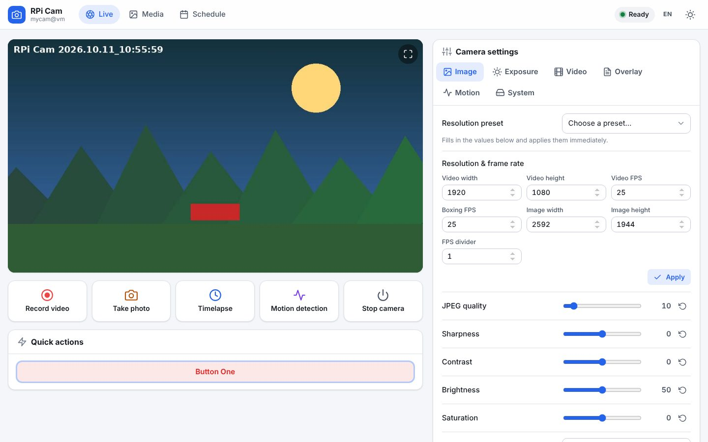
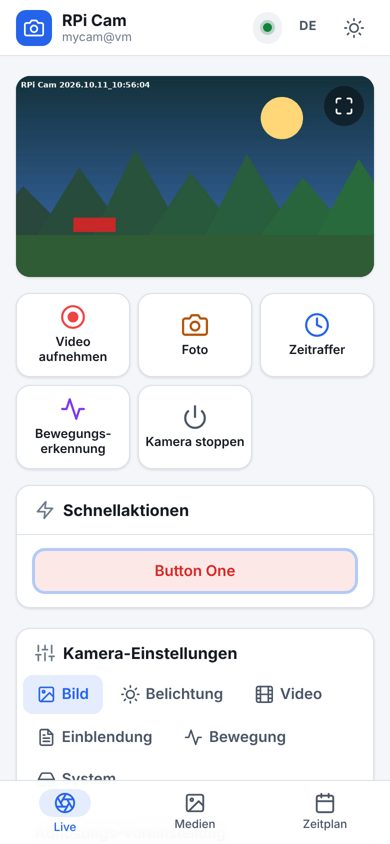
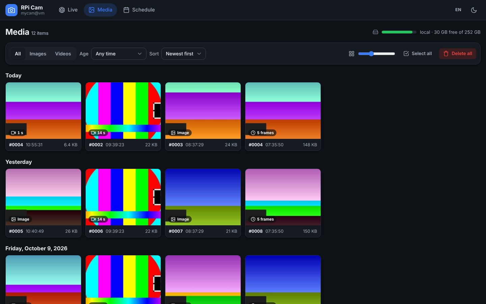
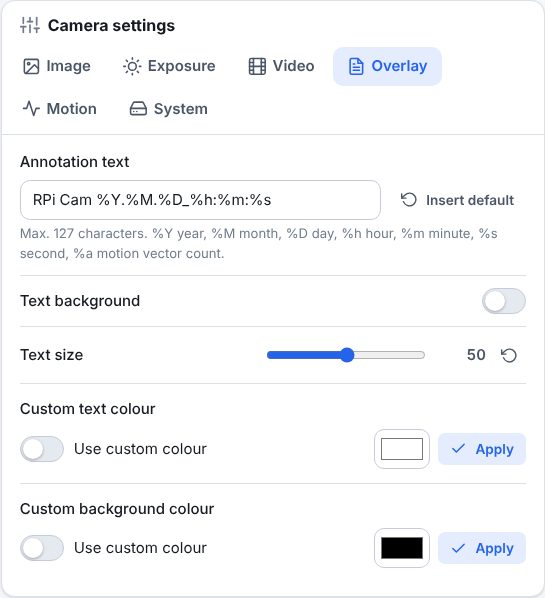

# RPi Cam Web Interface – Rework

Web interface for the Raspberry Pi camera: live view, video, photos, timelapse, motion detection,
scheduling and a media gallery. This fork modernises the user interface of the
[original RPi Cam Web Interface](https://github.com/silvanmelchior/RPi_Cam_Web_Interface) and fixes
a number of bugs and security problems. The new camera daemon `rpicamd` brings support for current
boards and cameras (Pi 5, Camera Module 3, 64-bit Raspberry Pi OS, USB webcams). The command protocol
is unchanged, so existing setups, macros and integrations keep working.

Current version: **7.1.0** – see [CHANGELOG.md](CHANGELOG.md).



| Mobile (German) | Media gallery | Overlay settings |
| --- | --- | --- |
|  |  |  |

## Features

- Responsive interface for phone, tablet and desktop with a bottom navigation bar on phones
- Light, dark and automatic theme, English and German interface (`www/lang/`)
- Live preview with status indicator, recording badge, fullscreen (also via `#full` in the URL)
  and an automatic pause while the browser tab is hidden
- Camera settings grouped in tabs; changes apply immediately, sliders with reset to default,
  colour pickers for the annotation colours
- Media gallery grouped by day with lightbox viewer (keyboard and swipe navigation), multi-select,
  ZIP download, lock/unlock, delete and timelapse-to-video conversion
- Scheduler with sun based, all day or fixed time periods, per-day selection, purge rules and a
  searchable command reference
- No external frameworks or CDNs – everything works offline on the Pi

## Camera support

The web interface talks to a camera daemon through a FIFO. `install.sh` installs one of two daemons
that understand the same commands:

- **rpicamd** (`backend/rpicamd.py`, new): uses **libcamera/Picamera2** for every Raspberry Pi camera on
  every Raspberry Pi with Raspberry Pi OS Bullseye or newer (32- and 64-bit), and **V4L2** for USB webcams
  and cameras of other boards.
- **raspimjpeg** (original program, legacy MMAL camera stack): used on Buster, and on Bullseye when
  *Legacy Camera* is enabled in `raspi-config`.

`camerabackend="rpicamd"` or `"raspimjpeg"` in `config.txt` overrides the automatic choice.

### Boards

| Board | Camera | Notes |
| --- | --- | --- |
| Pi 1, 2, 3, Zero, Zero W, Zero 2 W | ✅ | Pi 1 and Zero: keep the video size at 720p or lower |
| Pi 4 | ✅ | |
| Pi 5 | ✅ | H.264 is encoded in software (1080p30 works) |
| Pi 400, Pi 500/500+ | ✅ USB webcam | no camera connector |
| Compute Module 1, 3, 3+, 4, 4S, 5 | ✅ | camera ports as wired on the IO board; with two cameras choose one in the *Image* tab |
| First Pi Zero (v1.2, 2015) | ✅ USB webcam | no camera connector |
| Other boards (Orange Pi, Banana Pi, Radxa, ODROID, Jetson, x86 …) | ✅ USB webcam | CSI cameras of these boards only if their kernel offers a plain V4L2 capture device (set `v4l2_device`) |

### Cameras

| Camera | Works | Notes |
| --- | --- | --- |
| Camera Module 1 (OV5647), 2 (IMX219), HQ Camera (IMX477), incl. NoIR | ✅ | rpicamd and raspimjpeg |
| Camera Module 3 (IMX708), all variants | ✅ rpicamd | autofocus (manual, single, continuous) and lens position in the *Exposure* tab |
| Global Shutter Camera (IMX296), AI Camera (IMX500 as a normal camera) | ✅ rpicamd | |
| Arducam and other libcamera cameras (IMX519, 64MP, OV9281, IMX462, IMX708 boards …) | ✅ rpicamd | install the driver/overlay as the vendor describes; when `rpicam-hello --list-cameras` lists the camera, rpicamd can use it |
| USB/UVC webcams | ✅ rpicamd | brightness, contrast, saturation and sharpness are set with `v4l2-ctl` |

### Differences between the daemons

- Only raspimjpeg: image effects, colour effect, video stabilisation, raw layer, image statistics, HDMI
  preview, H.264 quantisation, watchdog and saving motion vectors. The settings page hides what the
  running daemon can not do.
- rpicamd: rotation 0° and 180° plus flips (libcamera has no 90°/270°); motion detection compares
  pictures on a macroblock grid and uses the same settings (noise, threshold, start/stop frames, mask).
- Video is recorded at most at 1920×1080 by the hardware encoder of the Pi 1–4.
- raspimjpeg only works on 32-bit Buster/Bullseye with Camera Module 1/2/HQ; Buster and Bullseye are past
  their security support, so prefer a current Raspberry Pi OS with rpicamd.

rpicamd is new. It is tested with a synthetic camera and a simulated Picamera2, not yet on every board
and camera – please report problems with the board, OS, camera and the log (`scheduleLog.txt`).

## Installation

```bash
sudo apt-get install -y git
git clone https://github.com/DensenDeluxe/RPi_Cam_Web_Interface_Rework.git
cd RPi_Cam_Web_Interface_Rework
./install.sh          # interactive, ./install.sh q for a quiet install with the saved config.txt
```

The installer picks the camera daemon (see *Camera support*), installs what it needs (Picamera2,
OpenCV, ffmpeg, v4l-utils where available) and checks at the end that a camera is found.

The installer asks for the sub folder (default `html`, i.e. `http://<pi>/html/`), web server
(apache, nginx or lighttpd), port, an optional user/password and the PHP version (detected
automatically for Debian 9–13).

Other scripts: `./update.sh` (pull latest version and reinstall), `./start.sh`, `./stop.sh`,
`./debug.sh` (start with raspimjpeg output on the console), `./remove.sh`.

To convert timelapses into videos from the media page, install ffmpeg: `sudo apt-get install ffmpeg`.

## Configuration

| File (in the web folder) | Purpose |
| --- | --- |
| `raspimjpeg` / `uconfig` | camera defaults / settings changed in the interface |
| `/etc/raspimjpeg` (rpicamd only) | optional `v4l2_device /dev/videoN` (USB camera to use), `ffmpeg_encoder` (default `libx264`) |
| `userLevel` | user levels for authenticated users (`name:level`, see `userLevelExample`) |
| `userbuttons` | up to 12 quick action buttons running macros (see `userbuttonsD`) |
| `uPresets.html` | own resolution presets (examples per camera: `uPresets*-OV5647/IMX219/IMX477.html`) |
| `macros/` | scripts run by job macros and quick action buttons |
| `css/custom.css` | optional stylesheet loaded after the built-in one |
| `multiview.json` | cameras shown by `multiview.html` (see `multiview.jsonD`) |
| `diskUsage.txt` | storage locations shown on the media page (`name:path` per line) |

### User levels

Without a login everyone has full access. With the installer's user/password option the web server
asks for a login and `userLevel` assigns levels; users missing from the file get level 0.

| Level | Allowed |
| --- | --- |
| 0 | live view and quick action buttons |
| 2 | + media page (view and download) |
| 3 | + video, photo and timelapse, delete/lock media |
| 6 | everything: settings, motion detection, schedule, system functions |

The levels are enforced on the server for every request, not only hidden in the interface.

## HTTP interface for scripts and integrations

| URL | Description |
| --- | --- |
| `cmd_pipe.php?cmd=<command>` | send a raspimjpeg command, e.g. `cmd_pipe.php?cmd=im` (GET or POST) |
| `status_mjpeg.php?last=<status>` | long poll for the current status (`ready`, `video`, `halted`, …) |
| `cam_pic.php` | current preview JPEG |
| `cam_pic_new.php` | MJPEG stream |
| `cam_get.php` | current preview JPEG, used by multiview |
| `cam_picLatestTL.php` | latest timelapse image |
| `min.php` | live view only, e.g. for kiosk displays |
| `preview.php?preview=<thumbnail>` | open a recording in the media viewer |

The command list is shown on the schedule page (*Command reference*). Requests coming from other
web sites (CSRF) are rejected; scripts and tools such as curl or Home Assistant are not affected.

## Credits and license

Based on the RPi Cam Web Interface by Silvan Melchior, Robert Tidey and contributors.
Icons based on [Feather](https://feathericons.com) (MIT). See [LICENSE.txt](LICENSE.txt).

Original project, forum and wiki:
[GitHub](https://github.com/silvanmelchior/RPi_Cam_Web_Interface) ·
[Forum](https://forums.raspberrypi.com/viewtopic.php?t=63276) ·
[Wiki](https://elinux.org/RPi-Cam-Web-Interface)
